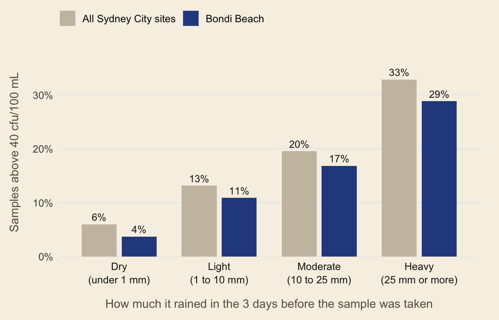

# Get started: does rain matter at my beach?

Sydney’s beaches are usually clean, but rain can wash stormwater and
sometimes sewage into the water. **beachrain** helps swimmers understand
how rainfall affects the water quality at **their** chosen beach.

## Installation

``` r
# install.packages("remotes")
remotes::install_github("ETC5523-2026/etc5523-assignment-4-abhignatippala")
```

## Launching the app

``` r
library(beachrain)
run_app()
```

Once you run the app, it opens in your browser, and you don’t need to
download any extra data because everything is already included in the
package.

## Using the app

The sidebar explains what the app does and who it is designed for. From
there, you can:

1.  **Choose your beach.** Beaches are grouped by region. Your selected
    beach shows up in blue, and the other beaches in the same region
    show up in beige.

2.  **Choose the level to check against.** You can select 40, 200 or 500
    cfu/100 mL, depending on the level you want to compare.

3.  **Choose the years and swimming season**. This helps you focus on
    the time period you want to explore.

## Interpreting the outputs

The **chart** groups samples based on how much rain fell in the 72 hours
before they were collected. Each bar shows the percentage of samples
above your chosen level. If the blue bars get higher from left to right,
it suggests that more rain is linked to a higher beach risk. If the blue
bars are lower than the beige ones, your beach has lower risk than the
surrounding region.

The **value boxes** show the results for dry weather and heavy rain. The
sentence below the chart explains these results in simple words.

**Faded bars** and a yellow warning appear when there are fewer than 10
samples in a group, such as at Henley Baths in Sydney Harbour. If no
samples match your selections, the app tells you what you can change to
see results.

The **Compare beaches after rain** tab ranks every beach in the region
by its *rain effect*: the wet-weather percentage minus the dry-weather
percentage.

## The analysis in code

``` r
library(beachrain)

bondi <- beach_samples[beach_samples$swim_site == "Bondi Beach", ]
bondi_summary <- summarise_exceedance(bondi, threshold = 40)
bondi_summary
#> # A tibble: 4 × 5
#>   rain_band                 n_samples n_exceed prop_exceed few_samples
#>   <fct>                         <int>    <int>       <dbl> <lgl>      
#> 1 "Dry\n(under 1 mm)"             215        8      0.0372 FALSE      
#> 2 "Light\n(1 to 10 mm)"           238       26      0.109  FALSE      
#> 3 "Moderate\n(10 to 25 mm)"        89       15      0.169  FALSE      
#> 4 "Heavy\n(25 mm or more)"         52       15      0.288  FALSE
```

`prop_exceed` shows the percentage of samples in each group that are
above 40 cfu/100 mL.

Compare Bondi Beach with the rest of Sydney City:

``` r
city <- beach_samples[beach_samples$region == "Sydney City", ]

plot_exceedance(
  bondi_summary,
  summarise_exceedance(city),
  selection_label = "Bondi Beach",
  context_label = "All Sydney City sites"
)
```



And see which beaches are affected the most when it rains:

``` r
head(compare_sites(city))
#> # A tibble: 6 × 7
#>   swim_site               n_dry n_wet pct_dry pct_wet rain_effect few_samples
#>   <chr>                   <int> <int>   <dbl>   <dbl>       <dbl> <lgl>      
#> 1 Coogee Beach              223   144    9.42    41.7        32.2 FALSE      
#> 2 Tamarama Beach            218   138    2.75    28.3        25.5 FALSE      
#> 3 Bronte Beach              219   141    4.57    29.8        25.2 FALSE      
#> 4 South Maroubra Rockpool   219   141    8.68    29.1        20.4 FALSE      
#> 5 Little Bay Beach          214   140    7.94    27.1        19.2 FALSE      
#> 6 Malabar Beach             222   144   16.2     34.7        18.5 FALSE
```

## Limitations

- Rainfall data comes from one location near Sydney Observatory Hill, so
  it might not capture storms that happen at individual beaches.

- The NHMRC levels (40, 200 and 500 cfu/100 mL) are intended for
  long-term 95th percentile assessments, not individual samples. Here,
  they are used as reference points.

- The results show past patterns and should not be used to judge today’s
  water quality.

## Data sources

Beachwatch NSW (NSW Government) and Open-Meteo (CC BY 4.0), curated for
TidyTuesday (20 May 2025) by Jen Richmond. See
`data-raw/beach_samples.R`.
